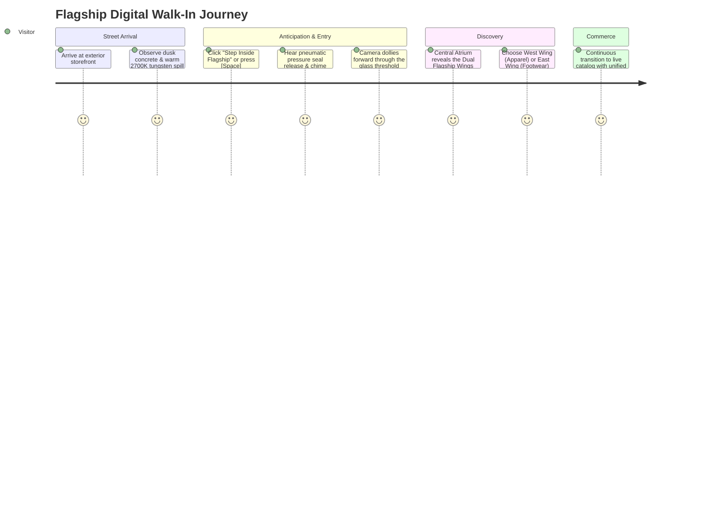

# EXPERIENCE_MAP.MD — VISITOR JOURNEY & SPATIAL THRESHOLDS

---

## 1. THE CINEMATIC ARRIVAL SEQUENCE

---

## 2. SPATIAL STAGES IN DETAIL

### Phase 1: Exterior Dusk Presence (Arrival & Street Context)
- **Visuals**: Fullscreen atmospheric dusk view of the physical flagship at Sector 5, NIT-5 Faridabad (`28.3846° N, 77.3086° E`).
- **Atmosphere**: Deep shadows, cold concrete exterior juxtaposed with warm interior tungsten light spilling onto the threshold.
- **Physical Clues**: Authentic metal architectural plate (`EST. 2024 / FARIDABAD SECTOR 5 / FLAGSHIP`).
- **Prompt**: Restrained, prominent CTA `"Step Inside Flagship"` with keyboard prompt `[SPACE]`.

### Phase 2: Threshold Crossing (Anticipation & Entry)
- **Trigger**: Click or Spacebar.
- **Acoustics**: Low sub-bass thud (90Hz $\rightarrow$ 32Hz) followed by synthesized pneumatic air seal hiss and 2-tone resonant acoustic chime (523Hz $\rightarrow$ 659Hz).
- **Optics**: Smooth forward camera push (`scale 1.0 -> 1.12 -> 1.03`), glass sheen dissolve, exterior facade expanding outward and softly fading.

### Phase 3: Central Atrium (The Dual Wings Reveal)
- **Spatial Layout**: Symmetrical architectural atrium:
  - **West Wing (KAPDA MAFIA Apparel)**: 440 GSM loopback cotton, 18 silhouettes, double-hood fleece, selvedge denim.
  - **East Wing (SHOES MAFIA Footwear Vault)**: Dual-density sole, 8 colorways, retro court high-tops, surgical sole glow.
- **Wayfinding**: Clear, authentic architectural labeling (`CENTRAL ATRIUM // PROCEED TO WING`).

### Phase 4: Direct Commerce Handoff
- **Action**: Selecting either wing smoothly docks into the active store environment.
- **Continuity**: Zero page reload, zero layout shift, instant commerce availability, shared bag state across both worlds.

---

## 3. USER ACCESSIBILITY & ESCAPE HATCHES
- **ESC / Skip**: Immediate exit via `[ESC]` or top-right button `"Skip to Store [ESC]"`.
- **Acoustics Toggle**: Persistent top-right control (`Volume2` / `VolumeX`) with local storage state retention.
- **Reduced Motion Support**: Respects `prefers-reduced-motion` media queries with immediate crossfades instead of scale pushes.
