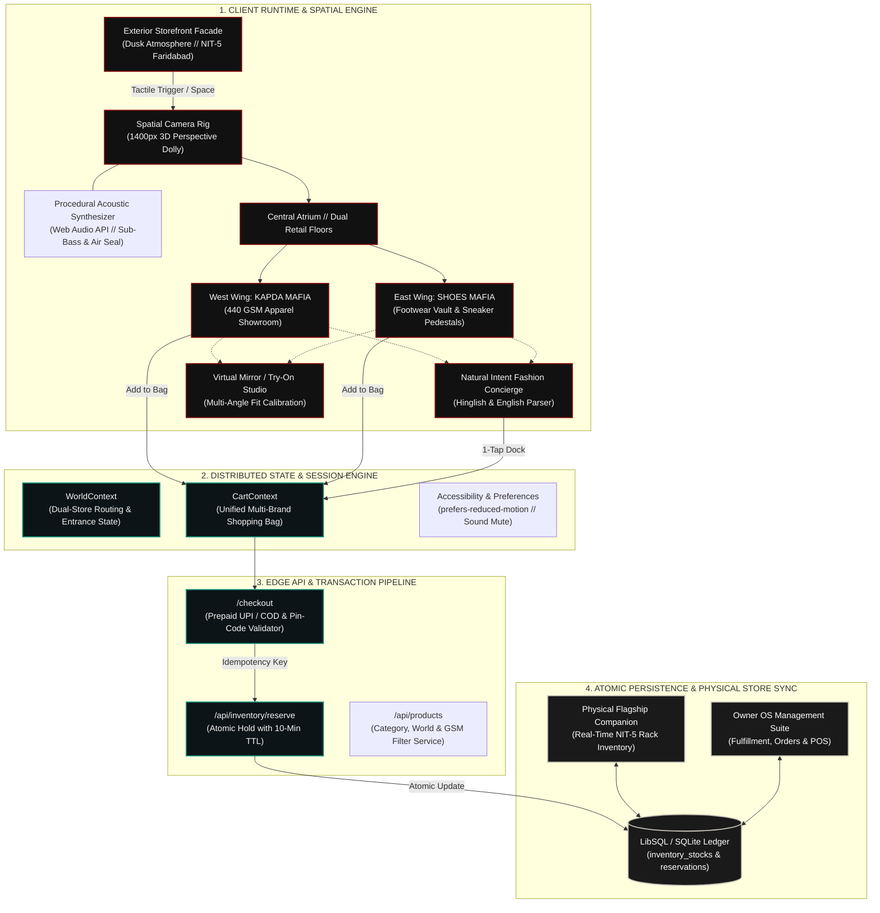
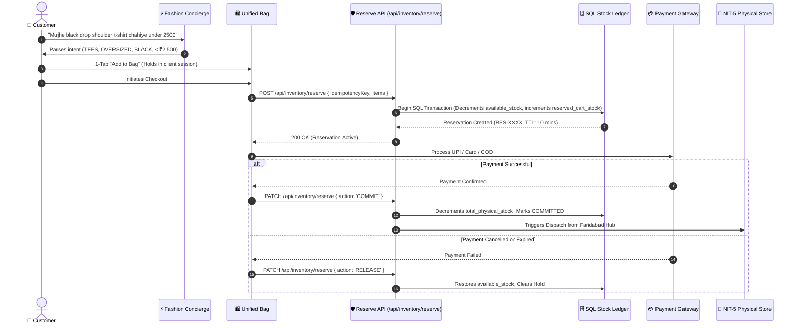

# KAPDA MAFIA × SHOES MAFIA
### Architectural Digital Flagship & Dual-World Commerce Engine

[](https://kapda-mafia.vercel.app/)
[](https://nextjs.org/)
[](https://react.dev/)
[](https://www.typescriptlang.org/)
[](https://tailwindcss.com/)
[](https://developer.mozilla.org/en-US/docs/Web/API/Web_Audio_API)

> **Live Deployments:**  
> • Primary Flagship: [https://kapda-mafia.vercel.app/](https://kapda-mafia.vercel.app/)  
> • Secondary Portal: [https://kapdamafia.vercel.app/](https://kapdamafia.vercel.app/)  
> • Brand Domain: [https://kapdamafia.com](https://kapdamafia.com)  
> • Physical Flagship: NIT-5, Faridabad, Haryana, India (`28.3846° N, 77.3086° E`)

---

## 1. Executive Summary & Brand Positioning

**KAPDA MAFIA** is an architectural digital flagship engineered for a high-end Indian streetwear and footwear house. Unlike conventional e-commerce platforms that rely on generic templates, Shopify themes, or cookie-cutter SaaS layouts, this platform was conceived and built from the ground up by a **senior multidisciplinary digital product agency**.

The platform is designed to command **₹2,500 – ₹6,000 price points** by delivering tangible physical-world presence, material density (280–500 GSM loopback cotton, brutalist concrete, 2700K tungsten halogen lighting), and an unhurried, restrained luxury experience.

```
BUSINESS GOAL → USER EXPERIENCE → CREATIVE DIRECTION → INTERACTION DESIGN → TECHNICAL DECISION → CODE
```

---

## 2. End-to-End System Architecture Pipeline

The platform operates as a cohesive, distributed omnichannel pipeline connecting the physical flagship in **NIT-5 Faridabad** with high-throughput cloud edge commerce:



---

### End-to-End Transaction Pipeline Sequence




### Key Experience Pillars
- **Continuous Architectural Entrance (`SpatialShowroomSequence.tsx`)**: Eliminates artificial slide labels, timeline scrubbers, and cartoon door flaps. Uses an unbroken optical forward camera dolly (`scale 1.0 -> 1.12 -> 1.03` with `cubic-bezier(0.16, 1, 0.3, 1)`) that dissolves the dusk exterior plane into the central atrium.
- **Dual Retail Worlds, One Commerce Engine**:
  - **KAPDA MAFIA (West Wing)**: Raw, heavyweight streetwear. 440 GSM loopback cotton, selvedge denim, double-hood fleece, and tactical cargos. Obsidian (`#080808`), Ecru (`#C8C3B8`), and Faridabad Oxblood (`#7D0A0A`).
  - **SHOES MAFIA (East Wing)**: Kinetic street footwear culture. Dual-density EVA running soles, vulcanized retro court high-tops. Deep Coal (`#090D0F`) and Cold Cyan (`#1A8F7A`).
  - **Shared Session**: Customers can purchase apparel and sneakers in a single unified bag without session fragmentation or duplicate checkouts.
- **Natural Fashion Concierge (`conciergeSearch.ts`)**: Built into the search system to parse real human intent (e.g., *"Mujhe black drop shoulder t-shirt chahiye under 2500"*) into exact category, budget, fit, and GSM filters, accompanied by direct in-situ Virtual Try-On and 1-tap **Add to Bag** actions.
- **Zero-Latency Procedural Acoustics (`soundEffects.ts`)**: Zero external MP3/WAV assets. Synthesized completely on-demand via the Web Audio API (sub-bass 90Hz floor resonance, pneumatic air seal release, and 2-tone resonant studio chimes).

---

## 3. Technology Stack & Engineering Standards

| Layer | Technologies & Implementations | Rationale |
| :--- | :--- | :--- |
| **Framework** | Next.js 16.3.0 (Turbopack, App Router) | Sub-second static generation (`SSG`), server components for catalog data, ultra-low bundle size. |
| **Runtime & Core** | React 19.2.8 + TypeScript 5.9.3 | Strict type contracts across products, variants, cart items, and order reserves. Zero `any` types. |
| **Design System** | Tailwind CSS v4 + Semantic CSS Tokens (`globals.css`) | Strict token architecture: Obsidian canvas, raw steel hairlines (`#1E1E1E`), warm chalk typography (`#F4F4F4`). |
| **Spatial Graphics** | CSS 3D Transforms (`perspective: 1400px`) + Framer Motion | 60fps GPU-composited motion without heavy WebGL bloat. Graceful fallback on mid-tier mobile hardware. |
| **Acoustics** | Web Audio API (Oscillators, Biquad Filters, Noise Buffers) | 0kB network payload, 0ms latency, 100% offline-ready, user-controlled toggle with local storage persistence. |
| **Database & State** | LibSQL / SQLite + Supabase Client (`services/database.ts`) | Distributed edge persistence with local offline fallback for catalog, orders, and customer accounts. |
| **Inventory Ledger** | Atomic SQL Reservations with Idempotency (`/api/inventory/reserve`) | Prevents overselling during high-traffic drops. 10-minute temporary checkout hold with automated release/commit. |

---

## 4. Directory & Module Architecture

```
KAPDA-MAFIA/
│
├── MASTER_PRODUCT_AGENCY_DIRECTIVE.md # The 30-pillar sovereign agency charter
├── AGENT.md                           # Operating charter, Intent > Implementation doctrine
├── DESIGN_DIRECTION.md                # Aesthetic guidelines, palette tokens, typography rules
├── EXPERIENCE_MAP.md                  # Physical walk-in user journey & threshold mapping
├── ARCHITECTURE.md                    # Technical module tree, state sync & sound engine specs
├── QUALITY_GATE.md                    # 9-step agency inspection rubric & audit scorecard
│
└── src/
    ├── app/
    │   ├── layout.tsx                 # Root layout with font optimization & global providers
    │   ├── page.tsx                   # Server-rendered home page data fetching
    │   ├── globals.css                # Semantic design tokens & spatial camera rig
    │   ├── shop/                      # Filterable, sortable apparel & footwear catalog
    │   ├── product/[slug]/            # High-conversion PDP with smart size modal & in-store mode
    │   ├── store/                     # Physical flagship locator (NIT-5 Faridabad)
    │   ├── checkout/                  # Unified prepaid & COD checkout with PIN validation
    │   ├── lookbook/                  # Cross-world editorial lookbooks (Shop the Look)
    │   └── api/
    │       ├── products/              # Catalog query API with world filtering
    │       ├── inventory/             # Real-time stock status across rack and warehouse
    │       └── inventory/reserve/     # Idempotent, transaction-safe cart reservation engine
    │
    ├── components/
    │   ├── SpatialShowroomSequence.tsx# Core spatial entrance (Exterior -> Threshold -> Dual Wings)
    │   ├── SearchModal.tsx            # Natural language fashion concierge with in-situ actions
    │   ├── DualHomePage.tsx           # Context-aware store switcher (Kapda vs Shoes)
    │   ├── Navbar.tsx                 # Fixed luxury header with world toggle & cart count
    │   ├── Hero.tsx                   # Editorial campaign showcase & walk-in action
    │   ├── ShoesMafiaView.tsx         # Footwear vault UI with 3D pedestal showcase
    │   ├── MafiaMirrorDrawer.tsx      # Virtual Try-On / Magic Mirror drawer
    │   ├── PhysicalStoreCompanion.tsx # In-store barcode/rack companion for walk-in customers
    │   └── CartDrawer.tsx             # Slide-out unified bag with live inventory timers
    │
    ├── context/
    │   ├── WorldContext.tsx           # Active store world ('clothing' | 'shoes') & entrance state
    │   └── CartContext.tsx            # Unified bag state across dual retail worlds
    │
    ├── services/
    │   ├── conciergeSearch.ts         # Natural language intent parser (Hinglish + English)
    │   ├── catalog.ts                 # Catalog abstraction layer with filter algorithms
    │   └── database.ts                # LibSQL database connection pool & schema migrations
    │
    ├── data/
    │   └── products.ts                # Master product catalog with GSM and physical rack metadata
    │
    └── utils/
        └── soundEffects.ts            # Procedural Web Audio API sound generator
```

---

## 5. Strict Anti-AI Design Philosophy

To guarantee the website never feels AI-generated, every component is audited against our **Anti-AI Law**:

| Banned AI / Template Pattern | Agency-Grade Replacement in Kapda Mafia |
| :--- | :--- |
| **Generic Chatbot Bubbles** | **Flagship Concierge**: Integrated directly into top search. Translates conversational queries into structured catalog results with instant Try-On and 1-tap bag actions. |
| **Fake Counters & Stock Warnings** | **Real Data Authenticity**: Genuine fabric specs (440 GSM loopback cotton, 100% combed yarn), real Indian logistics metrics, and atomic inventory ledgers. |
| **Cartoon Door Flaps / Jump Cuts** | **Continuous Camera Rig**: 3D spatial perspective (`1400px`) that dollies through the physical entrance with optical depth dissolve and pneumatic sound release. |
| **Desktop Squeezed into Mobile** | **Mobile-First Touch Ergonomics**: Native touch targets ($\ge 44\text{px}$), swipeable gallery cards, and fixed bottom navigation bar (`MobileBottomBar.tsx`). |
| **Disjointed Store Hopping** | **Unified Cross-World Commerce**: Apparel from Kapda Mafia and footwear from Shoes Mafia share one persistent cart and unified checkout. |

---

## 6. Getting Started & Local Development

### Prerequisites
- Node.js `20.x` or later (tested with `v24.16.0`)
- npm `10.x` or later

### Installation
```bash
# Clone the repository
git clone https://github.com/iamkavishnagpal-hash/Kapda-Mafia.git
cd Kapda-Mafia

# Install dependencies cleanly
npm install

# Start development server with Next.js Turbopack
npm run dev
```

Visit [http://localhost:3000](http://localhost:3000) to view the application.

### Production Build & Verification
```bash
# Execute full TypeScript check and Turbopack production compilation
npm run build

# Start production server locally
npm run start
```

---

## 7. Deployment & Continuous Delivery

The repository is configured for direct continuous deployment to **Vercel Production**:

```bash
# Deploy latest verified build directly to production
npx vercel --prod --yes
```

**Production Endpoints:**
- Main: [https://kapda-mafia.vercel.app/](https://kapda-mafia.vercel.app/)
- Secondary: [https://kapdamafia.vercel.app/](https://kapdamafia.vercel.app/)
- Brand Domain: [https://kapdamafia.com](https://kapdamafia.com)

---

## 8. Master Brief & Quality Documentation

For deep architectural and agency-level documentation, consult the root master brief suite:
- [`MASTER_PRODUCT_AGENCY_DIRECTIVE.md`](./MASTER_PRODUCT_AGENCY_DIRECTIVE.md) — The 30-pillar sovereign agency directive.
- [`AGENT.md`](./AGENT.md) — Operating charter, *Intent > Implementation* doctrine, and 8-stage execution formula.
- [`DESIGN_DIRECTION.md`](./DESIGN_DIRECTION.md) — Color token system, typographic hierarchy, lighting & motion tokens.
- [`EXPERIENCE_MAP.md`](./EXPERIENCE_MAP.md) — Visitor journey, spatial thresholds, and acoustic triggers.
- [`ARCHITECTURE.md`](./ARCHITECTURE.md) — State management, Web Audio API specs, and inventory reservation architecture.
- [`QUALITY_GATE.md`](./QUALITY_GATE.md) — The 9-step agency inspection scorecard and verification criteria.

---

## 9. Agency Credits & Copyright

Designed and engineered as a bespoke, agency-grade digital flagship for **KAPDA MAFIA & SHOES MAFIA**.  
© 2024–2026 Kapda Mafia Ltd. All rights reserved.
